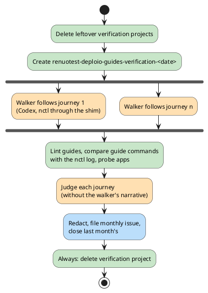

# LLM as a Reader

Once a month, an AI agent follows the guides on a real Deploio account, the way a new customer would.
A second model judges each guide by what actually happened, and renuobot files one issue per month with a section per guide.
A guide passes when its text needs no change.



Green steps are deterministic, orange steps use a model, blue talks to GitHub.

## Why it is built like this

- **The walker must not silently fix a guide.** `shim/nctl` stands in for `nctl` and logs every call.
  `lib/literal-check.mjs` compares the logged calls with the commands in the guides.
  `lib/guide-commands.mjs` finds commands a shell would not run as written, without any model.
- **The walker does not grade itself.** The judge sees the guides, the evidence and the walker's structured claims, never its narrative.
  The verdict follows from the judge's findings (`lib/judge.mjs`), so "pass" always means the same.
- **The repository is public.** Issues and workflow artifacts are visible to anyone.
  Everything leaving the walker is redacted (`lib/redact.mjs`), and the verification project is deleted after each run.
- **The walker stays in its project.** The shim refuses other projects, logging in, creating or deleting projects and `nctl apply`.

## Journeys

`prompts/<journey>.md` lists the guides of a journey in order and tells the walker who it is and when it is done.
`prompts/_reader.md` holds the rules for every walker, `prompts/_judge.md` the judge's.
Every page in `docs/` is either in exactly one journey or in `not-walked.yml` with a reason; a test enforces this.

## Setup

GitHub repository secrets:

- `OPENAI_API_KEY`
- `LLM_READER_NCTL_API_CLIENT_ID` and `LLM_READER_NCTL_API_CLIENT_SECRET`: an API service account of the `renuotest` organization that may create projects
- `RENUOBOT_GITHUB_TOKEN`: fine-grained token of renuobot with read and write access to issues of this repository

GitHub repository variables, pinned on purpose so month-to-month changes come from the guides and not from the models:

- `LLM_READER_WALKER_MODEL`: an OpenAI model for Codex
- `LLM_READER_JUDGE_MODEL`: an OpenAI model for the judge, preferably a different one

## Usage

```bash
npm run test:llm-as-a-reader   # unit tests, no network

# Walk one journey yourself: needs nctl logged in, Codex logged in, and a project you can throw away
LLM_READER_PROJECT=renuotest-my-test LLM_READER_ORGANIZATION=renuotest LLM_READER_WALKER_MODEL=... \
  tests/llm-as-a-reader/bin/walk.mjs go
LLM_READER_JUDGE_MODEL=... OPENAI_API_KEY=... tests/llm-as-a-reader/bin/judge.mjs tests/llm-as-a-reader/results
tests/llm-as-a-reader/bin/report.mjs tests/llm-as-a-reader/results --month 2026-12 --journeys '["go"]' \
  --title-file /dev/stdout --body-file /dev/stdout
```

In GitHub Actions, run the workflow "LLM as a Reader" by hand and name the journeys to walk only some of them.
